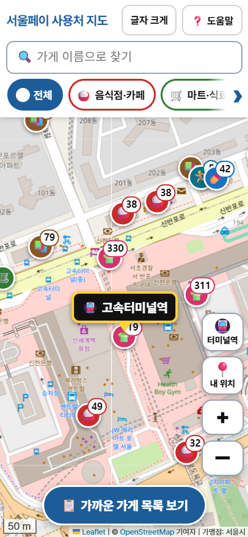
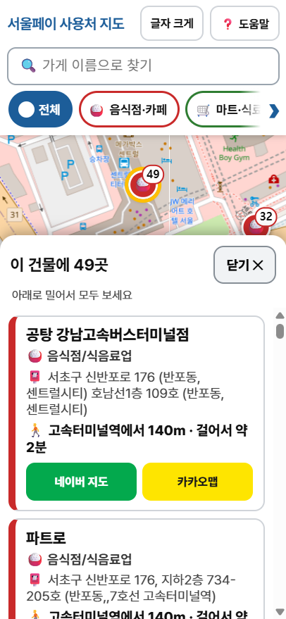

# 서울페이 사용처 지도

**👉 바로 열기: https://ofsungkyun.github.io/seoulpay-map/**

서울사랑상품권(서울페이) 가맹점을 **지도에서 바로** 찾아보는 웹페이지입니다.
어르신이 쓰시기 편하도록 큰 글씨, 큰 단추, 쉬운 말로 만들었습니다.

  
  &nbsp;&nbsp;
  

## 주요 기능

- 처음 화면 = **🚇 고속터미널역** 중심, 500m·1km 걸음 거리 원 표시
- **업종별 색깔 + 그림 아이콘**으로 구분 (아래 표), 위쪽 색깔 단추로 골라 보기
- 동그라미를 누르면 가게 이름·업종·주소·**고속터미널역에서 걸어서 몇 분**인지 표시
  (동그라미 위 숫자 = 그 건물에 있는 가게 수)
- **📋 가까운 가게 목록**: 고속터미널역(또는 내 위치)에서 가까운 순서
- **🔍 가게 이름 검색**, **📍 내 위치**, **🚇 터미널역**(처음 화면으로) 단추, **글자 크게** 단추
- 네이버 지도 / 카카오맵으로 바로 넘어가서 길찾기 가능
- 휴대폰 “홈 화면에 추가”하면 앱처럼 아이콘으로 실행

## 업종별 색깔과 아이콘

| 지도 표시 | 묶음 이름 | 포함된 서울페이 업종 |
|:---:|---|---|
| &nbsp;🍚 | **음식점·카페** | 음식점/식음료업 |
| &nbsp;🛒 | **마트·식료품** | 식자재/유통 |
| &nbsp;💊 | **병원·약국** | 보건/복지 |
| &nbsp;✂️ | **미용·생활** | 생활/리빙 |
| &nbsp;👕 | **옷·잡화** | 의류/잡화 |
| &nbsp;🏃 | **운동·문화·여행** | 문화/체육, 여행/숙박 |
| &nbsp;🔧 | **가전·가구·수리** | 가전/통신, 건축/철물, 가구/인테리어, 디자인/인쇄 |
| &nbsp;📚 | **학원·교육** | 기술/기능 교육, 입시/교습학원, 예술 교육, 외국어/언어, 기타교육기관 |
| &nbsp;🚗 | **자동차·주유** | 자동차/주유 |
| &nbsp;📦 | **기타** | 기타, 부동산/임대, 기업/기관 |

지도: [OpenStreetMap](https://www.openstreetmap.org/copyright) · 가맹점 자료: 서울사랑상품권 가맹점 현황(2026.8.10 기준)
